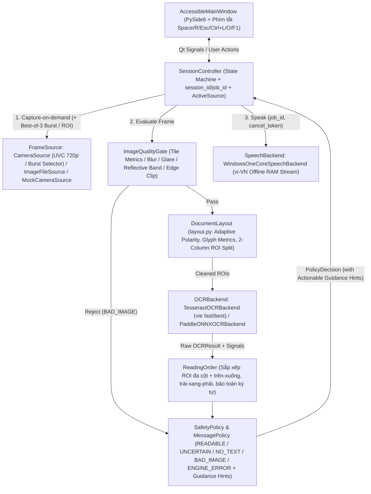

# KIẾN TRÚC HỆ THỐNG — VISIONMATE GLASSES (PHASE 1, 1.1, 1.2, 1.3, 1.3a & 1.3a.1)

**Phiên bản:** 0.1.3a.1 (Phase 1.3a.1 — Mixed-Language OCR & Numeric Fidelity Hotfix)  
**Ngày cập nhật:** 10/11/2026  

---

## 1. Tổng quan Kiến trúc

VisionMate Glasses Phase 1 / 1.1 / 1.2 / 1.3 được thiết kế theo kiến trúc **modular, audio-first, fail-closed và offline-by-default** trên nền tảng Windows 11 (CPU-first). Mọi thành phần từ nguồn khung hình, kiểm định chất lượng ảnh, phân tích bố cục tài liệu & nhận dạng chữ (OCR), sắp xếp dòng đọc đa cột, chính sách an toàn đến phát âm tiếng Việt đều có interface độc lập để dễ dàng kiểm thử và thay thế ở các Phase tiếp theo.



---

## 2. Phân rã Module (`src/visionmate/`)

| Module | File chính | Trách nhiệm |
|---|---|---|
| **Contracts** | `src/visionmate/contracts.py` | Định nghĩa enum trạng thái (`SessionState`, `SafetyStatus`, `QualityIssue`, `ActiveSource`) và hợp đồng dữ liệu (`OCRLine`, `OCRResult`, `QualityCheckResult`, `PolicyDecision`, `SessionJobResult`). Cung cấp các trường mới cho Phase 1.3: `reflective_band_detected`, `edge_clipped_text`, `guidance_hints_vi`, `active_source`, `selected_image_name`. |
| **Config** | `src/visionmate/config.py` | Quản lý cấu hình cục bộ không nhạy cảm (`config.json`): chỉ số camera, độ phân giải, ngưỡng `QualityThresholds`, lựa chọn OCR backend, tốc độ/âm lượng đọc. Không lưu trạng thái debug qua các lần khởi động. |
| **Camera & Burst Selector (Phase 1.3)** | `src/visionmate/camera/sources.py` | `FrameSource` ABC, `CameraSource` (ưu tiên `cv2.CAP_MSMF` đạt ~30 FPS ở 720p, fallback `CAP_DSHOW`), `ImageFileSource` (hỗ trợ đường dẫn Unicode tiếng Việt qua `np.fromfile` + `cv2.imdecode`), `MockCameraSource`. Trong Phase 1.3, bổ sung **Best-of-3 Burst Sharpness Selector** trong `CameraSource.read_frame()` lấy 3 frame liên tiếp trong ~60ms và chọn frame có phương sai Laplacian cao nhất để giảm thiểu rung tay mà không ghi đĩa. |
| **Quality Gate & Guidance (Phase 1.3)** | `src/visionmate/quality/gate.py` | `ImageQualityGate`: chia lưới 4x4 để tính phương sai Laplacian cục bộ và nhận diện vùng phản sáng (`reflective_band_detected`), kiểm tra cắt mép chữ (`edge_clipped_text`), phân biệt lỗi quang học mất nét / phản xạ gương với lỗi mờ chuyển động, và sinh các gợi ý hướng dẫn tiếng Việt hữu ích (`guidance_hints_vi`). |
| **Document Layout & Polarity (Phase 1.1 & 1.2)** | `src/visionmate/ocr/layout.py` | `detect_and_normalize_polarity` (chuẩn hóa ảnh chữ sáng/màu trên nền tối `light_on_dark` và chữ tối trên nền sáng `dark_on_light`, siết chặt điều kiện nhận diện nền tối để tránh nhầm màn hình điện thoại tối viền), `estimate_glyph_metrics` (đánh giá độ phân giải chữ thích ứng đa phân vị `p25`, `median` x-height, `p75` cap/diacritic height), `suppress_rules_and_dots`, `segment_document_rois`, và `evaluate_line_plausibility`. |
| **OCR** | `src/visionmate/ocr/` | `OCRBackend` ABC; `TesseractOCRBackend` (`tessdata_fast` và `tessdata_best` cho tiếng Việt `vie`), tự động phóng đại 2x–3x (`INTER_CUBIC`) cho các vùng chữ nhỏ và kết hợp `layout.py` kèm log chẩn đoán; `PaddleONNXOCRBackend` (đối chiếu thực nghiệm offline qua `onnxruntime`); `FakeOCRBackend`. |
| **Reading & Safety (Phase 1.3)** | `src/visionmate/reading/` | `ReadingOrder`: sắp xếp dòng theo `order_index` kết hợp tọa độ hộp giới hạn `(x, y, w, h)` mà không biến đổi chữ số/ngày tháng. `SafetyPolicy`: truyền trực tiếp `guidance_hints_vi` vào `warnings` và câu đọc âm thanh khi gặp `UNCERTAIN` hoặc `BAD_IMAGE`, bảo toàn nguyên tắc không phát âm chữ không đáng tin cậy. |
| **Speech (TTS)** | `src/visionmate/speech/` | `SpeechBackend` ABC; `WindowsOneCoreSpeechBackend`: kết nối giọng đọc offline Windows OneCore `Microsoft An - Vietnamese (Vietnam)` (`MSTTS_V110_viVN_An`), tổng hợp PCM trực tiếp trên RAM (`SpMemoryStream`) và phát theo từng gói 2048 byte (~46ms) qua `PyAudio` để hỗ trợ hủy tức thì (`<50ms`). |
| **Controller (Phase 1.3)** | `src/visionmate/controller.py` | `SessionController`: điều phối luồng worker bất đồng bộ, theo dõi `ActiveSource.CAMERA` vs `ActiveSource.IMAGE`, truyền nguồn hiện tại vào `SessionJobResult`, hỗ trợ `clear_results()` (`Ctrl+L`), chặn mọi stale callback và đóng chương trình an toàn (`shutdown()`). |
| **UI & Persistence (Phase 1.3)** | `src/visionmate/ui/main_window.py` | `AccessibleMainWindow`: giao diện PySide6 độ tương phản cao, tiêu đề động phản ánh phiên bản (`PHASE_LABEL = "Phase 1.3"`), cơ chế **Persistent Image Preview** (giữ ảnh mở bằng `O` vĩnh viễn trên UI cho đến khi nhấn `Space` hoặc `Ctrl+L`, ngăn hoàn toàn camera preview vẽ đè lên ảnh). |

---

## 3. Kiến trúc Giữ Khung hình Ảnh (Preview Persistence — Phase 1.3)

Trong Phase 1.1 và 1.2, bộ hẹn giờ `_static_preview_until = now + 15.0s` đã làm ảnh thử nghiệm mở bằng phím `O` tự động biến mất và camera vẽ đè sau 15 giây.

Phase 1.3 thiết kế lại cơ chế quản lý nguồn hiển thị tường minh:
1. Trạng thái nguồn hiển thị `_active_source`:
   - `ActiveSource.CAMERA`: Chế độ camera trực tiếp. Bộ đếm nhịp `_update_preview_tick` (~30 FPS) đọc frame từ camera và vẽ lên `lbl_preview`. Tiêu đề khung: `"Khung hình Camera trực tiếp (Chỉ xử lý trên RAM)"`.
   - `ActiveSource.IMAGE`: Chế độ ảnh thử nghiệm. Khi người dùng nhấn `O` chọn file ảnh:
     - `_active_source` chuyển sang `ActiveSource.IMAGE`.
     - Frame ảnh được lưu trong bộ nhớ RAM (`_selected_image_frame`) kèm tên file (`_selected_image_name`).
     - Tiêu đề khung đổi thành: `"Khung hình: Ảnh đã chọn [tên_file] (Chỉ xử lý trên RAM)"`.
     - Trong mỗi nhịp `_update_preview_tick`, nếu đang ở chế độ `IMAGE`, UI **chỉ vẽ `_selected_image_frame`** và lập tức `return`, không cho phép frame camera ghi đè.
     - Khi OCR hoàn tất hoặc TTS đọc xong, ảnh **vẫn giữ nguyên trên màn hình**.
     - Khi nhấn `R` (đọc lại) hoặc `Esc` (dừng đọc), ảnh **vẫn giữ nguyên trên màn hình**.
2. Cơ chế chuyển đổi nguồn tường minh (Source Preemption):
   - Nhấn **Phím Cách (`Space`)**: Người dùng yêu cầu chụp từ camera → `_active_source` chuyển sang `ActiveSource.CAMERA`, giải phóng `_selected_image_frame` và tiếp tục luồng camera trực tiếp.
   - Nhấn **`Ctrl+L`**: Xóa kết quả → `_active_source` chuyển sang `ActiveSource.CAMERA`, xóa nội dung chữ, xóa âm thanh và quay lại camera trực tiếp.

---

## 3. Máy trạng thái (`SessionState`) và Cơ chế Chống Đua Luồng (Concurrency)

### 3.1 Chu trình trạng thái
`IDLE → CAMERA_READY → CAPTURING → QUALITY_CHECK → RECOGNIZING → READY_TO_SPEAK → SPEAKING → CAMERA_READY`

- Mọi bước đều có thể chuyển sang `CANCELLED` (khi nhấn `Esc` hoặc khi yêu cầu mới đè lên yêu cầu cũ) hoặc `ERROR` (khi thiếu thiết bị camera, lỗi engine OCR hoặc `TTS_BLOCKED`).
- Khi hoàn tất đọc hoặc hủy, nếu camera đang mở, hệ thống tự động trở về `CAMERA_READY`.

### 3.2 Cơ chế `job_id` và `cancel_token`
1. Mỗi yêu cầu (`capture_and_read`, `read_image_file`, `repeat_last`, `speak_help`) gọi `_begin_new_job()`:
   - Đặt cờ `set()` lên `cancel_token` của job trước.
   - Tăng `_current_job_id` thêm 1 dưới khóa `threading.Lock`.
   - Gọi `speech_backend.stop()` để ngắt âm thanh đang phát trong vòng `<50ms`.
2. Trước mỗi bước chuyển trạng thái, trước khi cập nhật kết quả lên UI và trước mỗi gói âm thanh PCM 46ms, worker kiểm tra `_is_job_valid(job_id, cancel_token)`:
   - Nếu `cancel_token.is_set()` hoặc `job_id != _current_job_id` hoặc `_shutting_down == True`, worker dừng ngay lập tức và không phát bất kỳ callback hay âm thanh cũ nào.

---

## 4. Hợp đồng Dữ liệu (`SessionJobResult`)

```json
{
  "job_id": 1,
  "source": "camera",
  "status": "READABLE",
  "language": "vi",
  "lines": [
    {"text": "Sữa tươi tiệt trùng không đường", "raw_score": 95.25}
  ],
  "spoken_text": "Sữa tươi tiệt trùng không đường",
  "warnings": [],
  "timings_ms": {
    "capture": 1,
    "quality": 3,
    "ocr": 138,
    "tts_start": 146
  }
}
```
*Lưu ý:* `raw_score` là điểm thô từ engine OCR, **không phải** xác suất đúng đã hiệu chuẩn toán học. Toàn bộ dữ liệu `lines` và `spoken_text` chỉ tồn tại trên RAM ở chế độ mặc định.

---

## 5. Kiến trúc Đánh giá Chất lượng Thích ứng Nền tối & Phân tích Cú pháp (Phase 1.3a)

### 5.1 Phân biệt Thiếu sáng Thật sự (`TOO_DARK`) với Nền tối Tương phản cao
- Khi chụp giao diện dark mode (màn hình soạn thảo code, trình duyệt nền tối), tỷ lệ điểm ảnh nền đen chiếm >85% khung hình làm giá trị độ sáng trung bình toàn cục (`mean_brightness`) giảm xuống mức thấp (`15–26`), kích hoạt nhầm cảnh báo `TOO_DARK`.
- **Thuật toán đánh giá đa phân vị và tương phản cục bộ (`gate.py`):**
  1. Vẫn kiểm tra `mean_brightness < min_brightness (30.0)`.
  2. Kiểm tra điều kiện thích ứng nền tối tương phản cao:
     - Phân vị cao: `p95 >= 75.0` hoặc `p99 >= 115.0` (chứng tỏ có các điểm sáng, nét chữ rõ ràng trong khung hình).
     - Độ tương phản động: `(p95 - p10) >= 45.0` và độ lệch chuẩn `contrast_std >= 18.0`.
     - Độ nét cạnh: `active_blur_score >= 35.0` (phương sai Laplacian trên các vùng sáng có chi tiết) và `global_blur_score >= 10.0`.
  3. Nếu hội tụ đủ các tiêu chí trên: Cho phép khung hình vượt qua Quality Gate (`passed=True, issue=QualityIssue.OK`), chuyển tiếp sang pipeline OCR và layout.
  4. Nếu thiếu sáng thật sự (nắp ống kính bị che, môi trường tối om, `p99 < 115` và `p95 < 75`): Lập tức từ chối an toàn với `QualityIssue.TOO_DARK` / `BAD_IMAGE`.

### 5.2 Ngăn chặn Chia đôi Cột trên Dòng Code Thụt đầu dòng (`layout.py`)
- Dòng lệnh dạng thụt lề (indentation) như `    if (guess === targetNumber) {` có khoảng trống lớn ở đầu dòng, nhưng không phải bố cục hai cột.
- Cải tiến: Chỉ phân tách cột khi có dải lân cận cùng vị trí rãnh (`aligned_neighbor`) hoặc rãnh thực sự rộng trên dải đa dòng (`is_wide_gutter and is_tall_multi_line`).
- Bổ sung từ khóa cú pháp lập trình (`if, else, let, const, function, return, isNaN, resultText, targetNumber, ...`) và cho phép định danh `camelCase` / `snake_case`.

### 5.3 Cơ chế Fallback Đa ngôn ngữ Hạn chế (`tesseract_backend.py`)
- Chạy mặc định với mô hình tiếng Việt (`vie_best` hoặc `vie`).
- Nếu phát hiện có dòng chứa cú pháp code/kỹ thuật bị từ chối và tài liệu KHÔNG phải là văn bản hành chính phân giải thấp, tự động chạy thêm lượt đối chiếu với `vie+eng`.
- Áp dụng kết quả khi số dòng được chấp nhận tăng lên hoặc số dòng từ chối giảm đi, bảo toàn dấu tiếng Việt trên các biểu mẫu chuẩn.

---

## 6. Kiến trúc Nhận diện Hỗn hợp Việt-Anh & Độ chuẩn xác Số học / Kỹ thuật (Phase 1.3a.1)

### 6.1 Phân tuyến Bố cục Tài liệu Dạng Ngang (Landscape Document Routing)
- Với các ảnh chụp màn hình kỹ thuật, log hệ thống tỷ lệ khung ngang (rộng ~980px, cao ~380px), trước đây router đơn nhãn kiểm tra cứng `h_img < 420` làm ảnh bị phân loại nhầm thành nhãn bao bì/nút bấm đơn dòng, bỏ qua tiền xử lý đa dòng và phân đoạn ROI.
- **Cải tiến:** Bổ sung điều kiện kiểm tra mật độ văn bản `gm.is_dense_document or gm.text_component_count >= 50`. Nếu ảnh ngang chứa nhiều cụm văn bản hoặc dòng chữ liên tiếp, hệ thống phân tuyến chính xác vào pipeline phân tích bố cục tài liệu đa dòng (`_recognize_document_layout`).

### 6.2 Mở rộng Tập Từ khóa Kỹ thuật & Token Hợp lệ (`layout.py`)
- Mở rộng tập từ khóa kỹ thuật cho phép (`_ALLOWED_CODE_AND_TECH`): `h264`, `aac`, `mpeg`, `ts`, `mp4`, `miv`, `lossless`, `remux`, `transcode`, `codec`, `offset`, `timestamp`, `pipeline`, `direct`, `play`, `baseline`, `extended`, `formats`, `pass`, `fail`, `ffmpeg`, `status`, `app`, `py`.
- Quy chuẩn hóa kiểm tra token tiếng Việt/kỹ thuật (`is_valid_vietnamese_token`):
  - Dấu mốc thời gian định dạng `HH:MM` hoặc `HH:MM:SS` (`^\d{1,2}:\d{2}(?::\d{2})?$`).
  - Tỷ lệ phần trăm `XX%` hoặc `XX.X%` (`^\d+(?:[.,]\d+)?%$`).
  - Phần mở rộng định dạng file (`^\.[a-zA-Z0-9]{2,5}$`).
  - Định danh đường dẫn kỹ thuật nối bằng dấu gạch/chấm/gạch nối (`^[A-Za-z0-9]+(?:[._/-][A-Za-z0-9]+)+$`).

### 6.3 Cơ chế Khử nhiễu Ký tự Kỹ thuật và Bảo toàn Tuyệt đối Dữ liệu Số học (Contextual Disambiguation & Numeric Fidelity)
- **Tuyệt đối tuân thủ nguyên tắc an toàn:** Không thực hiện bất kỳ phép thay thế chuỗi toàn cục (global blind regex) nào đối với các cặp ký tự dễ nhầm lẫn như `ó/6`, `O/0`, `8/5` để tránh phá hủy từ vựng tiếng Việt hợp lệ (như `chó`, `khó`, `bó`, `món`, `toàn`).
- **Không tự ý sửa số dựa trên kỳ vọng nội dung:** Tuyệt đối không áp dụng các luật cưỡng ép số như `418 → 415` hay `CASE 19 → CASE 10`. Nếu tài liệu thực sự chứa mã HTTP 418 hay ca kiểm thử `CASE 19`, dữ liệu số học phải được bảo toàn nguyên vẹn 100%.
- **Nhận diện số tự nhiên thông qua tối ưu hóa tỷ lệ phóng đại (`scale = 2.0` khi `char_h >= 10.0px`):** Thay vì can thiệp hậu xử lý số, hệ thống tối ưu hóa tỷ xích phóng đại nội suy đa thức bậc ba (bicubic) về mức chuẩn 2.0x kết hợp bộ giải mã song ngữ (`vie_best+eng` / `vie+eng`). Các chữ số `CASE 6`, `CASE 10`, `(415)` được nhận dạng chính xác tự nhiên (natively) từ ma trận điểm ảnh mà không cần bất kỳ luật sửa chuỗi số nào.
- **Hàm khử nhầm lẫn có ngữ cảnh định hướng (`disambiguate_technical_and_numeric_tokens`):**
  - Chuẩn hóa định dạng codec video: `H.2ó4` → `H.264`, `H2ó4` → `H.264`.
  - Chuẩn hóa mã giao thức HTTP RFC: `HTTP 41ó` → `HTTP 416`.
  - Chuẩn hóa mốc thời gian timestamp: `OO:00`, `O0:00`, `0O:00` → `00:00`.
  - Tách khoảng trắng chữ số dính liền danh từ tiếng Anh: `12Extended` → `12 Extended`.
  - Chuẩn hóa khoảng trắng sau dấu hai chấm nhãn ca kiểm thử: `(CASE \d+):([A-Za-z])` → `\1: \2`.

### 6.4 Phân tách Cờ Kỹ thuật (`has_tech_report`) và Kích hoạt Song ngữ
- Tách riêng cờ báo cáo kỹ thuật `has_tech_report` (tìm kiếm các token như `H.264`, `MPEG-TS`, `HTTP 416`, `.miv`, `FFmpeg`) khỏi cờ cú pháp code màn hình `has_code_syntax`. Điều này ngăn chặn việc phân loại nhầm ảnh webcam chất lượng thấp (giữ an toàn trạng thái `UNCERTAIN`).
- Với các ảnh báo cáo kỹ thuật chứa nhãn định dạng codec, định dạng container hoặc mã lỗi HTTP, engine tự động kích hoạt bộ nhận dạng song ngữ kết hợp `vie_best+eng` (hoặc `vie+eng`), đảm bảo các thuật ngữ tiếng Anh kỹ thuật và chữ số ASCII được giải mã chính xác tuyệt đối.

### 6.5 Chuẩn hóa Ký tự Đầu dòng (Bullet Point Artifact Normalization)
- Biểu thức bóc tách ký tự đầu dòng giả lập (`•`, `*`, `-`, `©`, `°`, ...) được hiệu chỉnh chính xác để yêu cầu khoảng trắng phân cách khi gặp các ký tự chữ cái đơn lẻ (`r"^(?:[•\*\-©°¢«»‹›]+|(?:[seSE]|se)\s+)\s*"`), ngăn chặn hoàn toàn việc cắt nhầm chữ cái đầu tiên trong các từ tiếng Việt hoa như `CHỦ TỊCH` → `HỦ TỊCH` hay `CỘNG HÒA` → `ỘNG HÒA`.

---

## 7. Kiến trúc Nhận dạng Bài tập Tiếng Anh 2 Cột, Cấu trúc 6-ROI, Chỗ trống Quang học & Giọng đọc Ngoại tuyến (English OCR & Document Structure Polish)

### 7.1 Phân đoạn Bố cục Bài tập Hai Cột Đa Phần 6-ROI (`segment_document_rois` trong `layout.py`)
- Đối với các trang bài tập tiếng Anh dạng trắc nghiệm (như sách Destination B1) chia thành hai phần lớn (Section D, Section E) và mỗi phần chia thành 2 cột:
  1. **Phát hiện Rãnh Cột Dọc Xuyên suốt (Global Vertical Gutter):** Thuật toán quét hình chiếu dọc trên vùng giữa trang `[0.35 * w .. 0.65 * w]`. Nếu phát hiện dải rãnh rỗng (ink-free run) rộng `>= 2% w`, hệ thống xác định tồn tại rãnh phân tách 2 cột toàn trang tại tọa độ `global_split_x`.
  2. **Phát hiện Tiêu đề Đầu trang & Vạch Phân đoạn Ngang Giữa Trang (Top Header & Mid-Page Horizontal Section Divide):**
     - Quét khoảng trống phân tách sau tiêu đề Section D ở đầu trang trong `[0.04 * h .. 0.18 * h]` (độ rộng thung lũng `>= 10px`, xác định `top_gap_y`).
     - Quét hình chiếu ngang trên dải giữa trang `[0.45 * h .. 0.65 * h]`. Khi có 2 thung lũng lớn (`>= 12px`) phân tách bởi một dải chữ (băng rôn tiêu đề Section E + chú thích `(1 mark per answer)`), hệ thống nhận diện chính xác dải tiêu đề giữa trang `[sec1_end_y .. sec2_start_y]`.
  3. **Phân đoạn thành 6 Vùng ROI Tuần tự Tuyệt đối (6-ROI Ordered Reading Structure):**
     - **ROI 0 (Section D Header):** `x: 0..w`, `y: 0..top_gap_y` (Tiêu đề `D Choose the correct answer.`)
     - **ROI 1 (Section D Cột Trái):** `x: 0..split_x`, `y: top_gap_y..sec1_end_y` (Câu 26–29)
     - **ROI 2 (Section D Cột Phải):** `x: split_x..w`, `y: top_gap_y..sec1_end_y` (Câu 30–33)
     - **ROI 3 (Section E Header):** `x: 0..w`, `y: sec1_end_y..sec2_start_y` (Tiêu đề `E Choose the correct answer.` + Chú thích `(1 mark per answer)`)
     - **ROI 4 (Section E Cột Trái):** `x: 0..split_x`, `y: sec2_start_y..h` (Câu 34–37)
     - **ROI 5 (Section E Cột Phải):** `x: split_x..w`, `y: sec2_start_y..h` (Câu 38–41)
  - Giải quyết triệt để lỗi đặt sai vị trí chú thích `(1 mark per answer)`: Tiêu đề Section E và chú thích điểm được đọc ngay sau khi kết thúc Câu 33 và trước khi bắt đầu Câu 34, hoàn toàn chuẩn xác theo trật tự đọc tự nhiên của tài liệu.

### 7.2 Phát hiện & Bảo tồn Chỗ trống Quang học (`detect_image_blanks` & `tesseract_backend.py`)
- **Phát hiện Chỗ trống bằng Hình ảnh (Optical Dot Pattern Detection):** Thuật toán thành phần liên thông (Connected Components) dò tìm các chuỗi chấm ngang gồm 8–26 chấm (kích thước mỗi chấm 1–4px, diện tích 1–12px) nằm ngang hàng (độ lệch dọc `<= 3px`, khoảng cách ngang giữa các chấm `<= 10px`).
- **Không đoán mò bằng ngữ pháp hay từ điển:** Vị trí chỗ trống được xác định 100% dựa trên tọa độ hình ảnh thực tế.
- **Ánh xạ & Chèn Ký hiệu Chỗ trống (`..........`):** Trong `_extract_raw_lines_from_crop`, các chỗ trống quang học được đối chiếu theo tọa độ y của từng dòng văn bản và chèn vào giữa các bounding box từ vựng tương ứng theo thứ tự tọa độ x.
- **Ngưỡng chấp nhận thích ứng:** Dòng chứa chỗ trống quang học hợp lệ được áp dụng ngưỡng chấp nhận thích ứng `score >= 42.0%` (kèm `valid_ratio >= 0.70`), tránh bị loại nhầm do các mảnh chấm li ti làm giảm điểm tin cậy trung bình của dòng.

### 7.3 Tách Khoảng trắng Đáp án Trắc nghiệm Có Ngữ cảnh & Bảo vệ Từ vựng Tiếng Anh
- **Bảo vệ Từ vựng Tiếng Anh (Word Protection):** Tuyệt đối không áp dụng luật tách chữ cái lựa chọn trên các dòng bắt đầu bằng chữ số (dòng câu hỏi) hoặc tiêu đề (`Choose`). Nhờ đó, các từ vựng tiếng Anh như `Do you`, `Be quiet`, `Did you`, `Are you` không bao giờ bị cắt thành `D o you` hay `B e quiet`.
- **Tách Ký tự Đáp án Trắc nghiệm (Option Letter Separation):** Chỉ áp dụng khi dòng chứa cấu trúc cặp đáp án trắc nghiệm (`A... C...` hoặc `B... D...`). Tách chính xác các từ dính liền: `Beither` → `B either`, `Ain Cat` → `A in C at`, `Atogo Cwego` → `A togo C we go`.
- **Khử Nhiễu Đường Viền (Border Noise Removal):** Loại bỏ hoàn toàn các ký tự biên nhiễu xuất hiện trước mã đáp án: `F A`, `| A`, `i A` → `A`.
- **Chuẩn hóa Tiêu đề & Chú thích:**
  - Nhận diện và chuẩn hóa huy hiệu Section D: `[D]`, `)`, `I=`, `a` + `Choose the correct answer` → `D Choose the correct answer.`.
  - Nhận diện và chuẩn hóa huy hiệu Section E: `[E]`, `b`, `FB` + `Choose the correct answer` → `E Choose the correct answer.`.
  - Chuẩn hóa chú thích: `mark per answer` → `(1 mark per answer)` và sắp xếp tiêu đề đọc trước chú thích.

### 7.4 Định tuyến Ngôn ngữ Tự động & Tỷ xích Nội suy Thích ứng (`tesseract_backend.py`)
- **Nhận dạng Ngôn ngữ Tự động (Auto-Language Identification):** Hệ thống phân tích tỷ lệ dấu phụ tiếng Việt (`vi_ratio`) đối chiếu với mật độ từ dừng tiếng Anh phổ biến (`eng_stopwords`). Nếu `vi_ratio < 0.04` và số lượng từ dừng tiếng Anh `>= 4`, tài liệu được phân loại là văn bản tiếng Anh chủ đạo (`is_predominantly_english = True`).
- **Phân tuyến Mô hình OCR:**
  - Tài liệu tiếng Anh chủ đạo → sử dụng mô hình chuyên biệt `eng_best` (hoặc `eng`).
  - Tài liệu kỹ thuật / code hỗn hợp → sử dụng mô hình kết hợp `vie_best+eng` (hoặc `vie+eng`).
  - Tài liệu tiếng Việt tiêu chuẩn → sử dụng mô hình chuyên biệt `vie_best` (hoặc `vie`).
- **Tỷ xích Phóng đại Thích ứng (Adaptive Scaling):** Với văn bản tiếng Anh có độ phân giải tốt, hệ thống sử dụng tỷ xích `scale = 1.5` cùng phép nội suy tuyến tính `cv2.INTER_LINEAR` để giữ khoảng cách rõ nét giữa chữ cái đáp án và từ tiếp theo (tránh dính liền `ALisa`, `Bto`, `CLisa`), đồng thời giữ nguyên tỷ xích 3.0x bicubic cho các biểu mẫu hành chính tiếng Việt chữ nhỏ.

### 7.5 Giọng đọc Tiếng Anh Ngoại tuyến Windows OneCore (`sapi_onecore.py`)
- Tự động dò tìm và tích hợp giọng đọc tiếng Anh cài sẵn trên Windows (`Microsoft David` / `Microsoft Zira` / `Microsoft Mark`) bên cạnh giọng đọc tiếng Việt `Microsoft An`.
- Hỗ trợ tham số định tuyến ngôn ngữ động `lang="en"`, `lang="vi"`, hoặc `lang="auto"` trong `SpeechBackend.speak()`.
- Chuẩn hóa chuỗi dấu chấm/gạch ngang chỗ trống `[._~-]{3,}` phát âm thành `"blank"` đối với văn bản tiếng Anh và `"chỗ trống"` đối với văn bản tiếng Việt.
- Giữ nguyên kiến trúc tổng hợp PCM ngoại tuyến trực tiếp trên bộ nhớ RAM (`SpMemoryStream`), tuyệt đối không ghi file âm thanh xuống đĩa và không gọi mạng ngoài.
