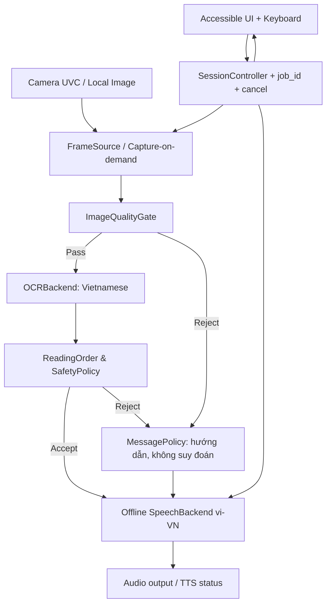

# VISIONMATE GLASSES — PRODUCT DESIGN DOCUMENT V0.1

**Ngày lập:** 09/11/2026  
**Trạng thái:** DESIGN BASELINE / CHƯA TRIỂN KHAI / CHƯA NGHIỆM THU  
**Hướng sản phẩm đã chọn:** C — trợ lý thị giác toàn diện, ưu tiên hỗ trợ sinh hoạt trước, hỗ trợ di chuyển nghiên cứu sau.  
**Nền tảng Phase 1:** Windows 11, webcam USB/tích hợp, CPU-first, xử lý cục bộ; Google Antigravity là tác nhân triển khai.  
**Nguyên tắc:** Không tự biến kết quả OCR/AI thành thông tin an toàn có độ chắc chắn cao nếu chưa được kiểm chứng.

---

## 1. Tầm nhìn và định nghĩa sản phẩm

VisionMate Glasses là hệ thống kính camera + phần mềm AI + giao diện âm thanh tiếng Việt, giúp người khiếm thị/người có thị lực yếu tiếp cận thông tin thị giác trong sinh hoạt. Dự án bắt đầu bằng phần mềm đọc chữ đáng tin cậy trên máy tính, sau đó mới tiến đến phần cứng đeo, trợ lý đồ vật và các cảm biến hỗ trợ nhận biết môi trường. Hệ thống là **công nghệ hỗ trợ**, không phải công cụ y tế, không thay thế người hướng dẫn di chuyển, gậy trắng, chó dẫn đường hay các giải pháp trợ giúp đã được huấn luyện.

### 1.1 Vấn đề thực tế
- Thông tin hằng ngày thường chỉ xuất hiện dưới dạng chữ in: nhãn sản phẩm, tờ hướng dẫn, hóa đơn, bảng ghi chú, nút điều khiển.
- Ứng dụng camera thông thường có quá nhiều thao tác thị giác, dễ làm gián đoạn trải nghiệm không dùng màn hình.
- OCR có thể nhận sai số, ngày tháng hoặc chữ in nhỏ; đọc sai với giọng điệu chắc chắn có thể gây hại.
- Thiết bị đeo cần cân bằng trọng lượng, nhiệt độ, thời lượng pin, âm thanh không che tiếng môi trường, quyền riêng tư và khả năng bảo trì.

### 1.2 Nhóm sử dụng
- **Chính:** Người khiếm thị hoặc thị lực yếu sử dụng tiếng Việt; nhu cầu ưu tiên đọc chữ in khi ở môi trường trong nhà có kiểm soát.
- **Phụ:** Người thân, người hỗ trợ, chuyên gia phục hồi chức năng; nhà phát triển và người kiểm thử.
- Không coi mọi người khiếm thị có cùng kỹ năng, khả năng nghe, nhu cầu hay thói quen. Trước khi thử nghiệm với người sử dụng thật phải lấy ý kiến tự nguyện và xây dựng quy trình hỗ trợ phù hợp.

### 1.3 Các nguyên tắc sản phẩm
1. **Audio-first, thao tác tối thiểu:** Một phím/nút để đọc; đọc lại, dừng, hướng dẫn đều hoạt động không cần nhìn màn hình.
2. **Fail-closed:** Nếu hình mờ, không có chữ, lỗi OCR hoặc không có giọng Việt, thông báo đúng giới hạn thay vì bịa đáp án hay im lặng giả như thành công.
3. **Privacy by default:** Không lưu video, ảnh, văn bản nhận dạng và âm thanh khi chưa bật tùy chọn rõ ràng; xử lý offline ở Phase 1.
4. **Lõi dễ thay thế:** Camera, OCR, TTS, phân tích chất lượng ảnh và UI có interface độc lập.
5. **Đo lường trước khi mở rộng:** Không chuyển sang gọng kính hay dẫn đường khi Phase 1 còn lỗi cơ bản.

## 2. Phân kỳ sản phẩm và điều kiện mở phase

| Phase | Đầu ra trọng tâm | Điều kiện trước khi chuyển tiếp |
|---|---|---|
| P1 — Offline Vietnamese Reading | Ứng dụng Windows/webcam, OCR chữ in và TTS Việt, kiểm thử bộ dữ liệu chuẩn | Chạy được không mạng sau cài đặt; chức năng an toàn và số đo được xác nhận bởi người dùng |
| P2 — Wearable Integration | Gọng kính/camera UVC có dây, nút vật lý, âm thanh mở; xử lý vẫn ở máy ngoài | Đánh giá bố trí dây, nhiệt, trọng lượng, thao tác không dùng tay nhìn, độ ổn định camera |
| P3 — Everyday Assistant | Xử lý bỏ túi/điện thoại; tìm vật thể quen thuộc, mô tả giới hạn, chế độ hỏi đáp có kiểm soát | Đánh giá nhận diện nhầm và tương tác thực tế; thử nghiệm người dùng với đồng ý |
| P4 — Environmental Awareness Research | Cảm biến chiều sâu/đa cảm biến, nhận biết vật cản trong phạm vi được định nghĩa | Thiết kế safety case riêng, đánh giá false negative, độ trễ, các góc mù; không dùng để độc lập dẫn đường |
| P5 — Field Validation & Productization | Kiểm chứng với người dùng, thiết kế công nghiệp, nguồn điện, độ bền và pháp lý | Đạt các yêu cầu chất lượng, quyền riêng tư, độ tin cậy và quy định tương ứng |

**Ngoài P1:** dẫn đường đường phố, sang đường, dự đoán va chạm, khuyến nghị dùng thuốc, chẩn đoán sức khỏe, nhận dạng người, microphone ra lệnh bằng giọng nói, cloud API, camera nhiều luồng, huấn luyện mô hình lớn, app iPhone, gọng kính sản xuất thật.

## 3. User journeys và chức năng Phase 1

### 3.1 Kịch bản U1 — Đọc nhãn sản phẩm
1. Người dùng khởi động ứng dụng và nghe/nhìn trạng thái camera sẵn sàng.
2. Hướng nhãn vào webcam, nhấn **Space** (hoặc nút **Đọc chữ**).
3. Hệ thống lấy **một khung hình** từ camera; kiểm tra độ rõ, sáng, vùng chữ; OCR tiếng Việt; giữ nguyên chữ/số nhận được; xác định thứ tự đọc hợp lý.
4. Nếu đạt gate, hệ thống đọc kết quả bằng giọng Việt; nếu không đạt, nói ngắn gọn cách chỉnh camera/ánh sáng.
5. Nhấn **R** đọc lại bản đã xác nhận; **Esc** dừng phát; **F1** nghe hướng dẫn phím.

### 3.2 Kịch bản U2 — Đọc từ ảnh thử nghiệm
- Người phát triển có thể mở ảnh cục bộ để kiểm thử mà không cần webcam (phím **O**, dialogue File Open). Đây là **dev/test mode**, không phải một chức năng đeo kính Phase 1.

### 3.3 Kịch bản U3 — Camera hoặc voice không khả dụng
- Không có camera: thông báo lỗi rõ ràng; app không crash, vẫn cho mở ảnh mẫu.
- Không có voice tiếng Việt offline: thông báo **TTS tiếng Việt chưa sẵn sàng**; hiển thị văn bản OCR; không giả giọng Việt đã hoạt động hoặc tự gọi cloud.
- Nút đóng/hủy trong khi OCR/TTS đang chạy: công việc cũ không phát âm về sau, không treo UI.

### 3.4 Requirements IDs

| ID | Mức | Yêu cầu |
|---|---|---|
| FR-01 | Must | Mở webcam UVC/tích hợp và hiển thị preview; chọn thiết bị khi nhiều camera |
| FR-02 | Must | Chụp một frame khi được yêu cầu, không OCR liên tục |
| FR-03 | Must | Gate chất lượng ảnh: quá mờ/tối/chói và ảnh không chứa văn bản → phản hồi thích hợp; ngưỡng qua config và test |
| FR-04 | Must | Đọc chữ in tiếng Việt, bảo toàn nguyên văn số/ngày tháng/đơn vị OCR nhận được, không tự diễn giải |
| FR-05 | Must | TTS tiếng Việt offline được xác minh; khi không có voice thì báo thiếu phụ thuộc |
| FR-06 | Must | Phím Space/R/Esc/F1/O và nút UI tương ứng, không lệ thuộc chuột |
| FR-07 | Must | Worker không chặn UI; hủy tác vụ, chống kết quả cũ, đóng chương trình an toàn |
| FR-08 | Must | Không tự động ghi/lưu ảnh, video, văn bản, âm thanh hoặc gửi ra mạng ở runtime |
| FR-09 | Must | Bộ test unit + integration + tập mẫu annotated, báo cáo CER/latency/memory |
| FR-10 | Should | Điều chỉnh tốc độ nói, âm lượng và phát lại, lưu cài đặt cục bộ không nhạy cảm |
| FR-11 | Should | Có chế độ debug chỉ dành cho developer, kích hoạt thủ công và cảnh báo dữ liệu nhạy cảm |
| FR-12 | Could | So sánh hai OCR backend trên cùng tập mẫu nếu CPU và thời gian cho phép; lựa chọn dựa vào dữ liệu |

## 4. Kiến trúc hệ thống



### 4.1 Chia module
- `CameraSource` — `open()`, `read_frame()`, `close()`; webcam và `ImageFileSource` cho test.
- `ImageQualityGate` — ước lượng độ nét (Laplacian variance có calibration), thiếu sáng/cháy sáng và hợp lệ input; không cho rằng một heuristic duy nhất bảo đảm đọc đúng.
- `OCRBackend` — `recognize(image) -> OCRResult` gồm text theo dòng, bounding box, confidence thô (nếu backend có), timing, lỗi; không coi score là xác suất đúng đã được hiệu chuẩn.
- `ReadingOrder` — sắp xếp dòng và nối văn bản, **không gọi LLM để sửa/đoán chữ hay số**.
- `SafetyPolicy` — phân loại `READABLE`, `UNCERTAIN`, `NO_TEXT`, `BAD_IMAGE`, `ENGINE_ERROR`; phần đọc số/ngày chỉ giữ output gốc và có thông báo dè dặt cho nhãn nhạy cảm.
- `SpeechBackend` — `list_voices()`, `speak(text, job_id)`, `stop()`, `shutdown()`, `is_vi_vn_available()`; backend offline có thể thay thế.
- `SessionController` — state machine và worker, không để UI thread OCR/TTS đồng bộ; mỗi yêu cầu có `job_id` tăng dần, chỉ job hiện hành được công bố/phát âm.
- `AccessibleDesktopUI` — trạng thái text lớn/tương phản tốt, accessible labels/roles, phím tắt, focus order; sự kiện lỗi phát ra thông báo có thể truy cập.

### 4.2 State machine
`IDLE → CAMERA_READY → CAPTURING → QUALITY_CHECK → RECOGNIZING → READY_TO_SPEAK → SPEAKING → CAMERA_READY`.

Bất kỳ bước nào cũng có thể đến `ERROR`/`CANCELLED`; `STOP/CLOSE` vô hiệu hóa tất cả callback của job cũ. Không phát đọc trùng khi lặp lệnh hoặc nhấn liên tục. Yêu cầu mới khi đang đọc: dừng tiếng cũ rồi mới xử lý yêu cầu mới, không xếp hàng vô hạn.

### 4.3 Hợp đồng dữ liệu tối thiểu
```json
{
  "job_id": 17,
  "source": "camera",
  "status": "READABLE",
  "language": "vi",
  "lines": [{"text": "Sữa tươi không đường", "raw_score": null}],
  "spoken_text": "Sữa tươi không đường",
  "warnings": [],
  "timings_ms": {"capture": 0, "quality": 0, "ocr": 0, "tts_start": 0}
}
```
*Các số 0 ở ví dụ là placeholder trong hợp đồng dữ liệu, không phải kết quả benchmark. Nội dung `lines` chỉ tồn tại trong RAM ở cấu hình mặc định.*

## 5. Lựa chọn công nghệ có kiểm chứng

### 5.1 Phase 1 đề xuất
- Python 3.11/3.12 (chọn bản tương thích thư viện sau preflight), OpenCV, PySide6, pytest.
- OCR candidate A: Tesseract với `vie.traineddata`, ưu tiên `tessdata_fast` để có baseline CPU; tùy chọn `tessdata_best` dùng đối chiếu độ chính xác.
- OCR candidate B: PaddleOCR `lang='vi'`, chọn model phù hợp và phiên bản **pin rõ**, chỉ dùng nếu kiểm thử thời gian và RAM chấp nhận được. Không tải nhiều model nặng vô điều kiện.
- TTS candidate: voice tiếng Việt offline của Windows nếu có, được **liệt kê và kiểm thử phát âm**. Nếu không có, thử backend offline có giấy phép và voice tiếng Việt được xác minh; nếu vẫn chưa có thì đánh dấu `TTS_BLOCKED`, không tráo thành cloud.
- `ONNX Runtime CPU` chỉ là tùy chọn triển khai khi mô hình cụ thể hỗ trợ; **không bắt buộc**.

**Quy tắc chọn backend:** Spike tối thiểu và ghi rõ phiên bản/package/model/hash/license/đường dẫn tải, kiểm tra offline sau cài. Việc model “hỗ trợ tiếng Việt” chưa chứng minh kết quả tốt trên nhãn tiếng Việt thật.

### 5.2 Cấu hình kiểm thử ban đầu
Windows 11; Core i5-1135G7, RAM 8 GB, MX330 2 GB nếu đúng cấu hình máy đang dùng. Thiết kế CPU-first; GPU chỉ tùy chọn không bắt buộc. 720p preview với capture-on-demand; downscale/crop theo backend và không làm mất khả năng đọc chữ nhỏ mà chưa đo lường.

## 6. An toàn, quyền riêng tư và trải nghiệm tiếp cận

### 6.1 Hành vi bắt buộc
- Khi không có chữ: “Mình chưa nhìn thấy chữ rõ để đọc.” Không tự sinh mô tả cảnh.
- Khi ảnh mờ: “Ảnh đang mờ, hãy giữ camera ổn định và đưa nội dung vào gần hơn.”
- Khi không chắc về nội dung: “Mình chưa đọc chắc chắn phần này, hãy thử lại.”
- Trường hợp nhãn thuốc, liều lượng, tên hóa chất, hướng dẫn an toàn: **không diễn giải thành chỉ định hoặc khẳng định tính an toàn**; cho phép đọc chữ thô kèm cảnh báo kiểm chứng với nguồn tin cậy/người hỗ trợ. Không chuyển text sai thành khuyến nghị.
- Không gọi API mạng trong runtime, không tự cập nhật, không lưu media theo mặc định. Trước khi bật ghi log debug phải hiện cảnh báo và có nút xóa.
- Không được dùng Phase 1 để qua đường, phát hiện xe đang tới hoặc định hướng di chuyển.

### 6.2 Thiết kế accessibility
- Điều khiển được hoàn toàn bằng bàn phím; nút có tên cho công nghệ đọc màn hình; tab order rõ; focus thấy được.
- Thông báo trạng thái ngắn, không nói lặp liên tục; người dùng luôn dừng đọc được.
- Âm lượng không che âm thanh môi trường khi về sau chuyển sang kính; ưu tiên tai nghe mở, không bịt kín trong trường hợp có rủi ro di chuyển.

## 7. Sơ bộ phần cứng và thiết kế tiến hóa

| Phần | P1 hiện tại | P2 đeo thử | P3/P4 về sau |
|---|---|---|---|
| Camera | Webcam laptop/USB UVC | Camera UVC nhỏ gắn gọng, kiểm soát FOV/cáp | Camera phù hợp điện thoại, có thể thêm depth |
| Xử lý | Laptop Windows | Laptop/bộ xử lý ngoài | Điện thoại hoặc thiết bị đeo/bỏ túi |
| Âm thanh | Loa/tai nghe máy tính | Open-ear/bone conduction được kiểm chứng | Audio ưu tiên không che tiếng môi trường |
| Điều khiển | Space/R/Esc/F1 | Nút lớn dễ phân biệt, rung tùy chọn | Phím/nút + giao diện thoại (đánh giá sau) |
| Pin/nhiệt | Nguồn laptop | Không tự gắn pin sát mặt trong prototype sớm | Thiết kế nguồn, vỏ, giới hạn nhiệt và an toàn điện riêng |

Chưa khóa BOM, trọng lượng, thời lượng pin, giá bán hoặc khoảng cách phát hiện vật cản: phải có khảo sát thiết bị và phép đo thực tế. Không mua linh kiện trước gate P1.

## 8. Kế hoạch kỹ thuật P1: Một nhiệm vụ trọn gói

### Bước 0 — Audit môi trường và phương án dự phòng
- Tạo repo/workspace **riêng** `VisionMateGlasses`, không sửa project/branch/sandbox khác.
- Ghi hệ điều hành, Python, CPU/RAM, webcam, quyền truy cập camera, thiết bị audio, danh sách TTS voices.
- Test dependency offline; mô tả rõ thiết lập một lần khi còn mạng và dùng offline sau đó.

### Bước 1 — Research spike OCR/TTS
- Dùng tập mẫu 10–15 ảnh chữ Việt có quyền sử dụng; đo Tesseract CPU, và PaddleOCR nếu cài được hợp lệ.
- Đo tốc độ, RAM đỉnh, chất lượng OCR và khả năng phát tiếng Việt trên máy thật.
- Chọn một OCR chính dựa trên đo đạc; giữ interface để thay backend; không hardcode model thiếu giấy phép.
- Nếu thiếu TTS offline Việt, xây UI và OCR thật, đánh dấu rõ blocker, không ngụy tạo phần audio.

### Bước 2 — App kiến trúc module
- Thiết kế classes như mục 4.1; camera preview; `Capture & Read`, `Repeat`, `Stop`, `Open Image`.
- Giao diện tiếng Việt, hỗ trợ keyboard, trạng thái camera/AI/TTS có thể đọc được.
- Cấu hình qua file local không nhạy cảm, không tạo network server.

### Bước 3 — Gates / callback safety
- Camera permission và missing device; ảnh lỗi; mờ/tối/không chữ.
- `job_id` chống kết quả OCR cũ; cancel trong worker và TTS; shutdown không callback trên UI đã hủy.
- OCR thô không được tự sửa ngày/số, xử lý lỗi Unicode tiếng Việt đúng.

### Bước 4 — Test suite / audit
- Unit tests cho quality gates, reading order, policy, cancellation, fake OCR/TTS backends.
- Integration tests cho webcam mock, file image, engine thật có sẵn, TTS offline đã xác minh.
- Kiểm thử thực tế với webcam và bộ ảnh có ground truth; thu số đo trên Windows hiện tại. Không dùng dữ liệu người lạ/nhạy cảm nếu thiếu quyền.

### Bước 5 — Handoff, không tự nghiệm thu
- Deliver runnable source, README cài đặt/chạy, script `start_windows.bat`, test command, sample dataset consent-safe, QA report, danh sách lỗi và limitations, screenshots, model hashes/licenses.
- Git commit trong nhánh dự án mới, working tree sạch nếu khả thi; không tự tag bản “đã nghiệm thu” hoặc merge khi chưa có chấp thuận.
- Nếu chưa đạt toàn bộ P1, bàn giao trạng thái **CONDITIONAL/BLOCKED** với bằng chứng.

## 9. Tiêu chí nghiệm thu đề xuất (targets, CHƯA phải kết quả)

| ID | Mục kiểm chứng | Target để đánh giá |
|---|---|---|
| A01 | Chạy offline | Sau cài đặt/pre-fetch model, ngắt mạng vẫn chụp ảnh, OCR, phát tiếng Việt nếu voice đã xác minh |
| A02 | Bộ mẫu cố định | >=70 ảnh có quyền sử dụng, manifest ground truth: 30 ảnh in rõ, 20 ảnh khó, 10 không có chữ, 10 ảnh chứa chữ số/ngày tháng (nhóm tách biệt) |
| A03 | Chữ Việt rõ | Trung vị CER <=5% trên nhóm 30 ảnh rõ; báo tỷ lệ từng ảnh và số ca fail; mục tiêu, không hứa đạt |
| A04 | Không có chữ | Trên 10 ảnh no-text, không phát biểu OCR như thể có văn bản thật trong cả 10 ca |
| A05 | Chữ số/ngày | Không có hậu xử lý tự biến đổi chữ số; mọi lỗi OCR số phải hiện trong error log đánh giá và không suy luận thành chỉ dẫn |
| A06 | Hiệu năng CPU | Thử ít nhất 30 lượt, báo P50/P95 thời gian từ yêu cầu đến bắt đầu âm thanh, mục tiêu P50 <=5s, P95 <=10s; nếu TTS_BLOCKED phải nêu chưa đo được |
| A07 | RAM ứng dụng | Peak working set mục tiêu <=1.5GB trên máy thử; đo cả load model và 30 lượt OCR; nêu công cụ đo |
| A08 | Trạng thái UI | Preview khi nhàn rỗi mục tiêu >=10 FPS 720p; UI không đông cứng khi OCR hoặc khi phát âm |
| A09 | Cancel/stale | 20 lần hủy và 20 lần đóng/chuyển yêu cầu khi worker bận không có âm thanh/kết quả từ job cũ; UI không crash |
| A10 | Accessibility | Space/R/Esc/F1/O hoạt động; focus/accessible names kiểm tra bằng keyboard và công cụ có sẵn |
| A11 | Quyền riêng tư | Không tạo file media/text mặc định, không có request ra mạng trong runtime theo kiểm chứng cấu hình offline |
| A12 | Thành thật trong QA | PASS chỉ khi có chứng cứ thực; khuyết TTS/voice/camera được đánh dấu BLOCKED hoặc CONDITIONAL |

**Lưu ý:** Các con số A02–A09 là **mục tiêu thiết kế ban đầu**, phải hiệu chỉnh sau benchmark, không phải ngưỡng đã được thẩm định lâm sàng hoặc chứng nhận an toàn. Bộ kiểm thử 70 ảnh chỉ là engineering smoke/benchmark, chưa đại diện cho mọi người dùng/điều kiện ánh sáng.

## 10. Những rủi ro/điểm cần chặn

| Rủi ro | Cách ứng phó |
|---|---|
| OCR sai số/ngày tháng với giọng nói chắc chắn | Tránh sửa đoán, nói rõ mức chắc chắn, từ chối lời khuyên y tế/an toàn |
| PaddleOCR tốn bộ nhớ khi tải pipeline | Preflight, chọn CPU model nhẹ; Tesseract baseline; đo RAM thật |
| Voice Việt offline không cài sẵn | List voice trước, backend fallback hợp lệ, trạng thái `TTS_BLOCKED` |
| Camera đeo bị rung/chói/vùng nhìn lệch | Phase 1 benchmark biến dạng ảnh và gate, P2 thử cơ khí trước |
| Người dùng bỏ qua gậy trắng vì tin AI | Không đưa chức năng dẫn đường trong P1; nhắc giới hạn và phối hợp chuyên gia ở P4 |
| Thu hình thông tin riêng tư | RAM-only mặc định, opt-in debug, không tự upload/cloud |
| Lỗi race/đọc lại kết quả cũ | `job_id` + cancel token + safe close + tests |

## 11. Cấu trúc bàn giao dự kiến

```text
VisionMateGlasses/
├── README.md
├── docs/
│   ├── PRODUCT_DESIGN_V0_1.md
│   ├── P1_QA_REPORT.md
│   ├── ARCHITECTURE.md
│   ├── SAFETY_AND_PRIVACY.md
│   └── MODEL_LICENSES.md
├── src/visionmate/
│   ├── app.py
│   ├── controller.py
│   ├── camera/
│   ├── quality/
│   ├── ocr/
│   ├── reading/
│   ├── speech/
│   └── ui/
├── tests/
│   ├── unit/
│   ├── integration/
│   └── fixtures/
├── scripts/
│   ├── start_windows.bat
│   └── check_environment.py
├── requirements.lock  # hoặc lockfile tương đương
└── .gitignore
```

Có thể điều chỉnh tên file/chi tiết package theo thực tế, nhưng không cắt bỏ lớp modularity, QA và safety. Không commit raw model nặng nếu chưa xác minh giấy phép; cung cấp download/setup minh bạch.

## 12. Quyền ra quyết định và gate nghiệm thu
- Chủ dự án quyết định phạm vi/tính năng và trực tiếp nghiệm thu sau khi thử phần mềm Windows.
- Google Antigravity chịu trách nhiệm triển khai, sửa lỗi, chạy test, báo cáo đúng kết quả và giữ nguyên các dự án khác.
- Phase 1 hoàn tất kỹ thuật **không** đồng nghĩa sản phẩm đã an toàn cho người khiếm thị dùng một mình hay đã sẵn sàng đeo ra đường.
- Phase 2 chỉ mở sau khi có bản giao P1, benchmark, báo cáo hạn chế và phê duyệt riêng.

## 13. Tài liệu kỹ thuật tham khảo (kiểm tra 09/11/2026)
- PaddleOCR multilingual / `lang='vi'`: https://www.paddleocr.ai/main/en/version3.x/pipeline_usage/OCR.html
- Tesseract models: https://github.com/tesseract-ocr/tessdoc/blob/main/Data-Files.md
- Tesseract Vietnamese model: https://github.com/tesseract-ocr/tessdata_best/blob/main/vie.traineddata
- Windows SpeechSynthesizer (phải có voice cài sẵn): https://learn.microsoft.com/en-us/uwp/api/windows.media.speechsynthesis.speechsynthesizer
- ONNX Runtime execution providers: https://onnxruntime.ai/docs/execution-providers/
- WHO: Blindness and vision impairment; rehabilitation and mobility: https://www.who.int/health-topics/blindness-and-vision-loss

---

**Định nghĩa hoàn tất tài liệu:** Đây là thiết kế Phase 1 và lộ trình tương lai; chưa có code, thử nghiệm hoặc chứng cứ chất lượng sản phẩm nào được tạo ra bởi tài liệu này.
